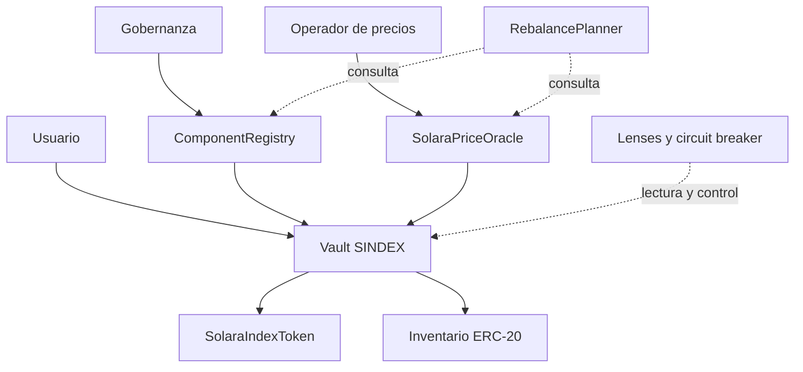

# Arquitectura y estados

`SolaraIndexProtocol` concentra custodia, emisión y redención. `ComponentRegistry` conserva el conjunto de activos y sus pesos; `SolaraPriceOracle` devuelve precios normalizados con heartbeat; `SolaraIndexToken` representa participaciones. Los módulos de lectura calculan planes y estados sin mover fondos.

Los cambios de pesos avanzan mediante programación, apertura de settlement y finalización. Los consumidores deben leer el estado actual y el bloque de referencia antes de emitir órdenes. Una estimación de `RebalancePlanner` no es una orden ejecutable ni una garantía de liquidez.
