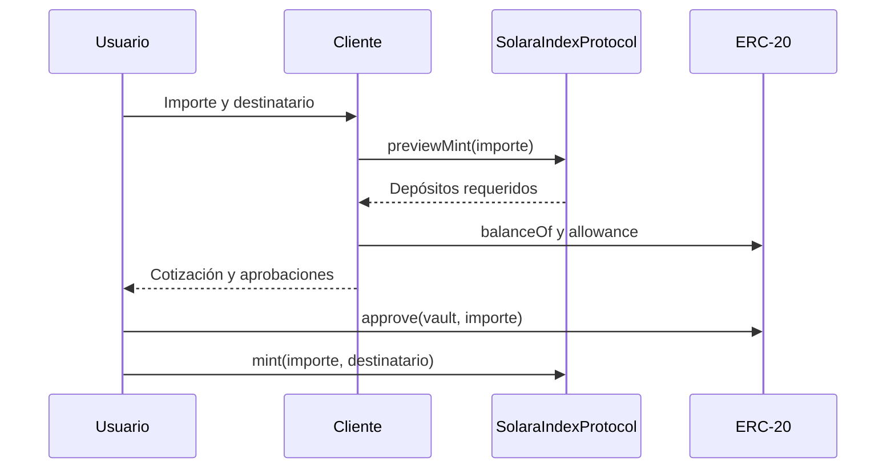

# Integración y cotizaciones

La interfaz consulta `previewMint` o `previewRedeem`, muestra activos y cantidades, solicita aprobaciones cuando corresponda y vuelve a cotizar antes de enviar la transacción. Debe registrar chain ID, dirección de vault y bloque de lectura para que el usuario sepa a qué estado pertenece la estimación.

Para operaciones de rebalance, `RebalancePlanner.currentPlan` devuelve valor actual, valor objetivo, pesos y delta por componente. `executionBounds(asset, valueDelta, slippageBps)` da nominal, mínimo a recibir y máximo a gastar. Con `valueDelta = 2 000`, WETH a `2 000` y tolerancia `100 bps`, el resultado es `1`, `0,99` y `1,01 WETH`. La banda es una herramienta de preparación; no ejecuta swaps ni garantiza profundidad de mercado.

Errores esperables: componente no activo, precio vencido, saldo o allowance insuficiente, límites del registro o estado de programación incompatible. Tras un error, refrescar estado y cotización; no reemitir transacciones con parámetros obsoletos.
