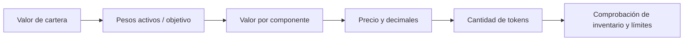

# Modelo económico del índice

Cada componente tiene peso en puntos básicos y un precio de 18 decimales. El valor total del portfolio es la suma de `balance_i × precio_i` normalizada por los decimales de cada token. La emisión solicita los componentes según pesos activos; el token SINDEX representa una participación sobre la cartera conforme al estado del contrato.

Ejemplo de fixture: con pesos USDC 80 %, WETH 10 % y WBTC 10 %, una emisión nominal de `1 000 SINDEX` requiere `800 USDC`, `0,05 WETH` a precio `2 000`, y `0,0025 WBTC` a precio `40 000`. Todas las cantidades se entregan en unidades nativas y son verificadas por `previewMint`.

El planificador calcula `valorObjetivo_i = valorTotal × pesoObjetivo_i / 10 000` y `delta_i = valorObjetivo_i − valorActual_i`. Un delta positivo representa necesidad de compra; uno negativo, exceso. `executionBounds` transforma el valor absoluto a tokens y expone una banda simétrica por tolerancia de deslizamiento, con redondeo conservador para el máximo gasto. La ejecución real exige un venue y controles independientes.
