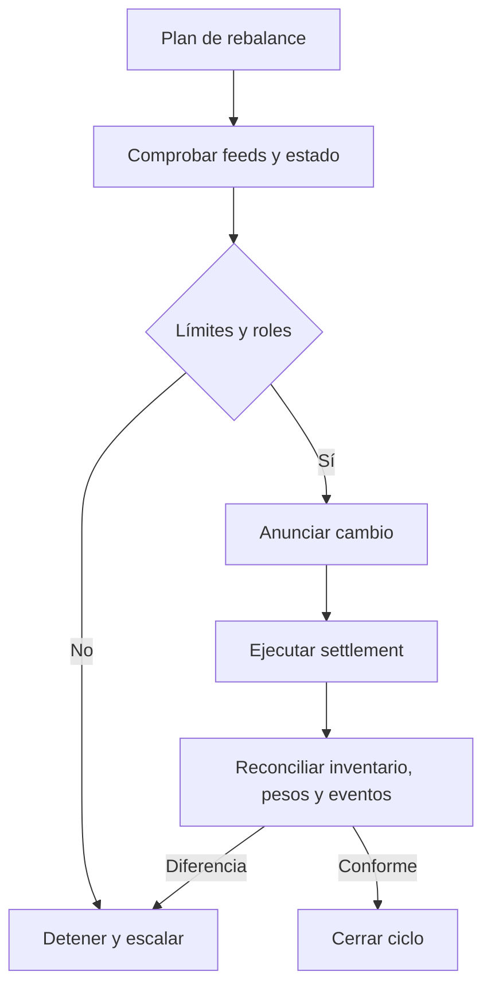

# Operación, controles y respuesta

Antes de publicar precios o iniciar un rebalance, comparar el NAV observado, los pesos de cartera, la antigüedad de los feeds y los límites por componente. Guardar los valores de entrada, el bloque y el hash de la decisión. Separar quien configura pesos de quien actualiza precios y de quien ejecuta operaciones.

La reconciliación debe comparar saldos ERC-20 de la bóveda, suministro SINDEX, precios y eventos. El circuit breaker puede detener rutas sujetas a umbrales; la pausa y la salida de emergencia tienen permisos específicos y deben ser ensayadas con los mismos parámetros que se usarían en una operación autorizada.

La suite `bash scripts/ci.sh` verifica formato, compilación y tests. El uso local de Foundry no implica despliegue de contratos, conexión a un RPC externo ni custodia real.
